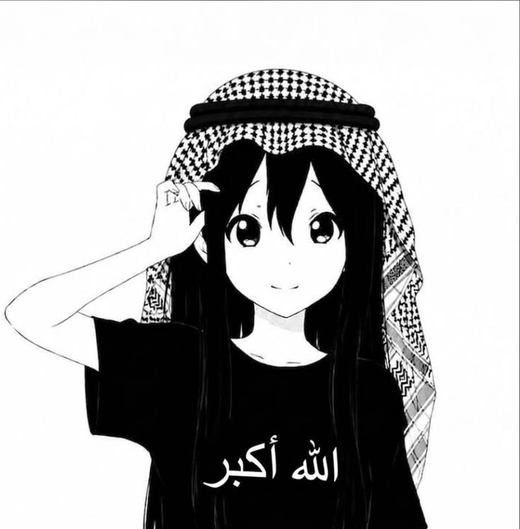
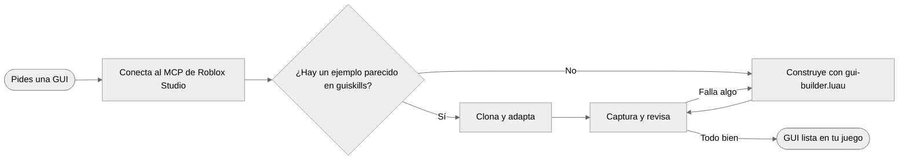
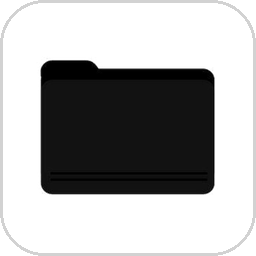
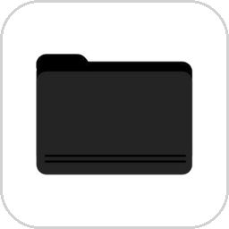
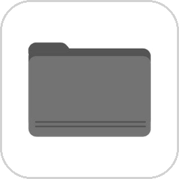
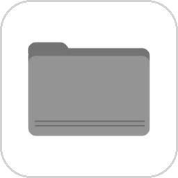
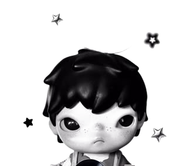

<div align="center">



<br/>


</div>

<br/>



## Qué es

**roblox-gui-kit** es una *skill* para [Claude Code](https://claude.com/claude-code). Le enseña a Claude a construir interfaces de Roblox con el mismo estilo de una librería de unas 150 GUIs de ejemplo (`Workspace.guiskills`): mismas fuentes, mismos colores, mismas texturas y mismos tamaños.

Nada está inventado. Los valores salen de **medir** esa librería.

| Instancias analizadas | ScreenGuis | Texturas únicas | Packs de estilo |
|:---:|:---:|:---:|:---:|
| ~80.000 | 150 | 1.094 | 3 |

<br clear="right"/>

<div align="center"></div>

## Instalación

Necesitas [Claude Code](https://claude.com/claude-code) y [Git](https://git-scm.com/).

**Windows (PowerShell)**
```powershell
git clone https://github.com/kolioty/roblox-gui-kit.git "$env:USERPROFILE\.claude\skills\roblox-gui-kit"
```

**Mac / Linux**
```bash
git clone https://github.com/kolioty/roblox-gui-kit.git ~/.claude/skills/roblox-gui-kit
```

Reinicia Claude Code. La skill se activa sola cuando pidas una GUI, botón, HUD, tienda o ventana de Roblox.

Para actualizar: `git -C ~/.claude/skills/roblox-gui-kit pull`

<div align="center"></div>

## Galería

<div align="center">

<br/>
<sub>Ilustración de los tres estilos dibujada con los trazos y capas medidos. No son capturas de Studio.</sub>
</div>

<br/>

| Estilo | Pack | Ideal para | Firma visual |
|---|---|---|---|
| **A · Chunky** (por defecto) | `guinew` | HUD, botones de acción | Gradiente vertical, trazo oscuro grueso, bevel |
| **B · Glossy** | `guipackv4` | Tiendas, compras, premios | Textura con brillo y texto con sombra |
| **C · Panel de studs** | `PACKGUIV7` | Ventanas, settings, listas | Fondo de patrón y doble borde |

<div align="center"></div>

## Cómo funciona



## Reglas medidas

| Regla | Dato de la librería |
|---|---|
| Tamaño en **Scale** + `UIAspectRatioConstraint` | 6.089 de 6.858 elementos de `guinew` usan Scale en X e Y |
| Fuente **GothamSSm** ExtraBold / Heavy, `TextScaled` | 913 textos en ExtraBold solo en `guinew` |
| Botón = fondo blanco + `UIGradient` a −90° | rotación −90° en 1.113 gradientes de `guinew` |
| Trazo oscuro grueso (4.5 – 5 px) | 2.080 trazos de ese grosor en `guinew` |
| Nombres fijos: `Title`, `Icon`, `Bevel`, `Studs`, `Outer`, `Close`, `ButtonTweenScale` | convención repetida en los 3 packs |

Los valores completos (colores, gradientes, radios, ids de textura) están en `references/`.

<div align="center"></div>

## Contenido

| | Archivo | Para qué sirve |
|:---:|---|---|
|  | `SKILL.md` | Flujo de trabajo de la skill |
|  | `references/design-tokens.md` | Fuentes, colores, trazos, radios y gradientes por estilo |
|  | `references/texture-catalog.md` | Ids de textura por rol: 9-slice, tiles, brillos, íconos |
|  | `references/component-recipes.md` | Árbol de botón, ventana y moneda, más el catálogo de 150 GUIs |
|  | `assets/gui-builder.luau` | Funciones para `execute_luau` |
|  | `assets/button-tween.client.luau` | Hover y press de botones |

## Ejemplo

Con Roblox Studio abierto y el MCP conectado, dile a Claude:

> *"Hazme una tienda con 3 botones de compra y un botón de cerrar"*
> *"Crea un HUD con dinero y velocidad abajo a la izquierda"*
> *"Copia la ventana de Settings pero en tonos azules"*

Por dentro usa los helpers del builder:

```lua
local GUI = ... -- assets/gui-builder.luau

local sg  = GUI.screen("Shop", game.StarterGui, 10, true)
local win = GUI.panel(sg, { Title = "Shop" })
GUI.button(win, { Text = "Buy", Color = "Green", Icon = GUI.Tex.Cash })
```

## Requisitos y límites

- Roblox Studio abierto con el **MCP de Studio** conectado a Claude.
- Para clonar ejemplos reales, tu lugar necesita la carpeta `Workspace.guiskills`. Sin ella, la skill usa los tokens y recetas de `references/`.
- El rol de cada textura se dedujo del nombre, el ScaleType y el uso, no de verlas una a una. Revisa siempre la captura.
- Los ids de textura son assets de Roblox y pueden necesitar permisos de uso en tu experiencia.

<div align="center"></div>

<table>
<tr>
<td valign="bottom">

**Hecho por Pedry**

Si te sirve, deja una estrella al repo.

<sub>Las ilustraciones de `docs/img` (manga, carpetas, figura y foto del banner) son arte de terceros tomado de Pinterest; no son mías ni del proyecto. Si eres el autor y quieres que se quite, abre un issue.</sub>

</td>
<td align="right" width="220">

</td>
</tr>
</table>
