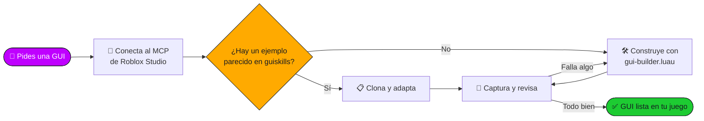
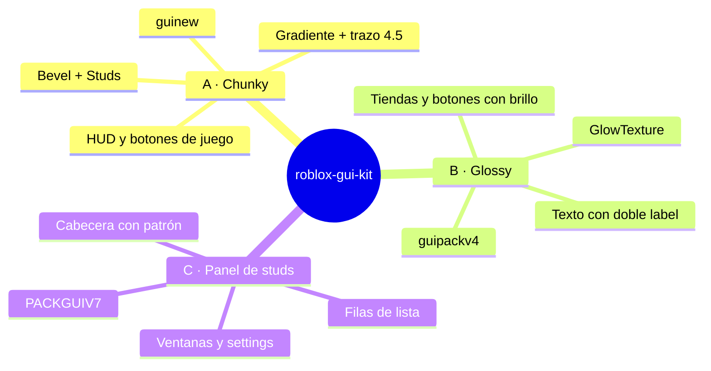
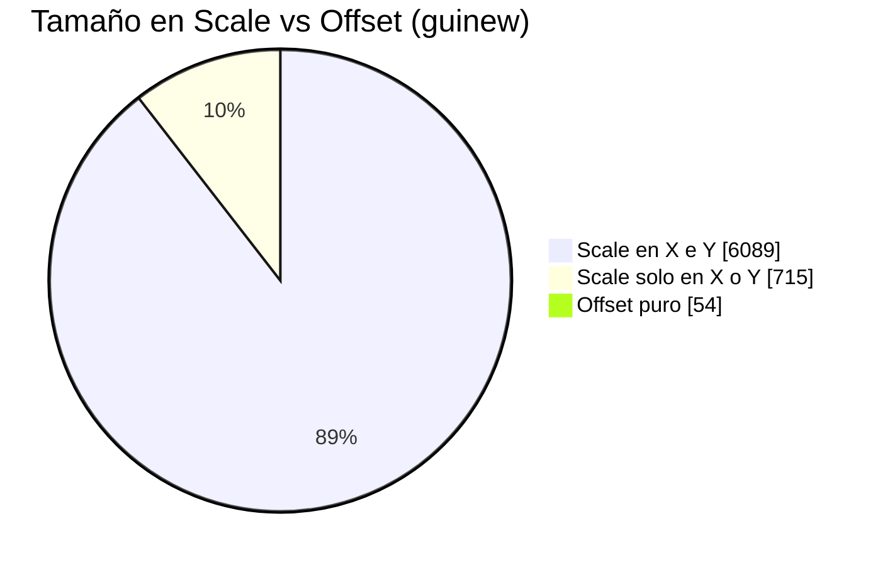

<div align="center">


<a href="https://github.com/kolioty/roblox-gui-kit">
  
</a>

<br/>


**Hecho por Pedry** 💜


</div>

## ✨ ¿Qué es?

**roblox-gui-kit** es una *skill* para [Claude Code](https://claude.com/claude-code) que le enseña a Claude a construir interfaces de Roblox **con el mismo look** que una librería de ~150 GUIs de ejemplo (`Workspace.guiskills`): mismas fuentes, mismos colores, mismas texturas y mismos tamaños.

No son valores inventados: salen de **medir** la librería real.

<div align="center">

| 📦 Instancias analizadas | 🖼️ ScreenGuis | 🎨 Texturas únicas | 🧩 Packs de estilo |
|:---:|:---:|:---:|:---:|
| **~80.000** | **150** | **1.094** | **3** |

</div>

<div align="center">


## 🖼️ Galería


<sub>Ilustración original de los 3 estilos, dibujada a partir de los valores medidos (colores, trazos, capas). No son capturas de Studio.</sub>


</div>

## 🚀 Instalación

> Requiere [Claude Code](https://claude.com/claude-code) y [Git](https://git-scm.com/).

<details open>
<summary><b>🪟 Windows (PowerShell)</b></summary>

```powershell
git clone https://github.com/kolioty/roblox-gui-kit.git "$env:USERPROFILE\.claude\skills\roblox-gui-kit"
```
</details>

<details>
<summary><b>🍎 Mac / 🐧 Linux</b></summary>

```bash
git clone https://github.com/kolioty/roblox-gui-kit.git ~/.claude/skills/roblox-gui-kit
```
</details>

Reinicia Claude Code y listo. La skill se activa sola cuando pidas una GUI, botón, HUD, tienda o ventana de Roblox.

**Actualizar:**
```bash
git -C ~/.claude/skills/roblox-gui-kit pull
```

<div align="center"></div>

## 🧠 Cómo funciona



---

## 🎨 Los 3 estilos



| Estilo | Pack | Ideal para | Firma visual |
|---|---|---|---|
| **A · Chunky** *(por defecto)* | `guinew` | HUD, botones de acción | Gradiente vertical + trazo oscuro grueso + bevel |
| **B · Glossy** | `guipackv4` | Tiendas, compras, premios | Textura con brillo y texto con sombra |
| **C · Panel de studs** | `PACKGUIV7` | Ventanas, settings, listas | Fondo de patrón + doble borde |

<div align="center"></div>

## 🌈 Paleta de gradientes

Parejas reales extraídas de la librería (de oscuro a claro):

| Color | Inicio → Fin | |
|---|---|---|
| Verde | `#1DCB32` → `#A6FF00` |   |
| Azul | `#007BFF` → `#00EAFF` |   |
| Morado | `#BF00FF` → `#FF72FF` |   |
| Rojo | `#BC0000` → `#FF6767` |   |
| Naranja | `#FF6900` → `#FFB36B` |   |
| Oro | `#FFAA00` → `#FFFF00` |   |
| Trazo oscuro | `#161A21` |  |
| Ventana (estilo C) | `#323241` |  |

---

## 📐 Reglas de oro (medidas, no inventadas)



- 📏 **Todo en Scale** + `UIAspectRatioConstraint` → se ve igual en móvil y PC.
- 🔤 **GothamSSm ExtraBold/Heavy**, `TextScaled`, texto blanco con `UIStroke` oscuro.
- 🎯 **Botón** = fondo blanco + `UIGradient` a −90° + `UIStroke` Border + `Bevel` + `Studs`.
- 🏷️ **Nombres consistentes**: `Title`, `Icon`, `Bevel`, `Studs`, `Outer`, `Close`, `ButtonTweenScale`.

<div align="center"></div>

## 📁 Contenido del repo

```text
roblox-gui-kit/
├── SKILL.md                         ← flujo de trabajo de la skill
├── docs/img/                        ← hero, galería y divisor (SVG originales)
├── references/
│   ├── design-tokens.md             ← fuentes, colores, trazos, radios, gradientes
│   ├── texture-catalog.md           ← ids de textura por rol (9-slice, tiles, glows, íconos)
│   └── component-recipes.md         ← árbol de botón, ventana, moneda + catálogo de 150 GUIs
└── assets/
    ├── gui-builder.luau             ← helpers para execute_luau
    └── button-tween.client.luau     ← hover / press de botones
```

---

## 🛠️ Ejemplo de uso

Dile a Claude, con Roblox Studio abierto y el MCP conectado:

> *"Hazme una tienda con 3 botones de compra y un botón de cerrar"*
> *"Crea un HUD con dinero y velocidad abajo a la izquierda"*
> *"Copia la ventana de Settings pero con colores azules"*

Y dentro, Claude usa los helpers:

```lua
local GUI = ... -- assets/gui-builder.luau

local sg  = GUI.screen("Shop", game.StarterGui, 10, true)
local win = GUI.panel(sg, { Title = "Shop" })
GUI.button(win, { Text = "Buy", Color = "Green", Icon = GUI.Tex.Cash })
```

---

## ⚠️ Requisitos y límites

- Roblox Studio abierto con el **MCP de Studio** conectado a Claude.
- Para **clonar ejemplos reales**, tu lugar necesita la carpeta `Workspace.guiskills`. Sin ella, la skill usa los tokens y recetas de `references/`.
- El rol de cada textura se dedujo de nombres, ScaleType y uso, no de verlas una a una: revisa siempre la captura.
- Los ids de textura son assets de Roblox y pueden necesitar permisos de uso en tu experiencia.

---

<div align="center">

### Hecho con 💜 por **Pedry**


⭐ Si te sirve, dale una estrella al repo.


</div>
