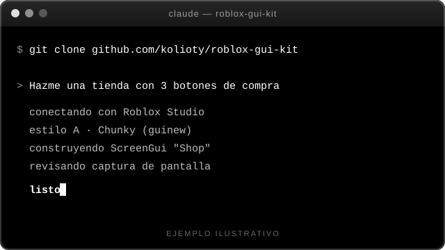

<h1 align="center">
  <a href="https://github.com/kolioty/roblox-gui-kit">
    
  </a>
</h1>

<h4 align="center">Skill de Claude para crear interfaces de Roblox con un estilo consistente, hecha para <a href="https://claude.com/claude-code" target="_blank">Claude Code</a>.</h4>

<p align="center">
  
</p>

<p align="center">
  <a href="https://github.com/kolioty/roblox-gui-kit/stargazers"></a>
  <a href="https://github.com/kolioty/roblox-gui-kit/forks"></a>
  <a href="https://github.com/kolioty/roblox-gui-kit/commits/main"></a>
  <a href="https://github.com/kolioty/roblox-gui-kit"></a>
  <a href="https://github.com/kolioty/roblox-gui-kit/issues"></a>
</p>

<br>

<table align="center">
  <tr>
    <td align="center">
      <a href="https://github.com/kolioty/roblox-gui-kit">
        
      </a>
    </td>
    <td align="center">
      <a href="https://www.star-history.com/#kolioty/roblox-gui-kit&Date">
        <picture>
          <source media="(prefers-color-scheme: dark)" srcset="https://api.star-history.com/image?repos=kolioty/roblox-gui-kit&type=date&theme=dark&legend=top-left" />
          <source media="(prefers-color-scheme: light)" srcset="https://api.star-history.com/image?repos=kolioty/roblox-gui-kit&type=date&legend=top-left" />
          
        </picture>
      </a>
    </td>
  </tr>
</table>

<p align="center">
  <a href="#instalación">Instalación</a> •
  <a href="#cómo-funciona">Cómo funciona</a> •
  <a href="#estilos">Estilos</a> •
  <a href="#reglas-medidas">Reglas</a> •
  <a href="#documentación">Documentación</a> •
  <a href="#solución-de-problemas">Problemas</a> •
  <a href="#créditos">Créditos</a>
</p>

<p align="center">
  roblox-gui-kit le enseña a Claude a construir GUIs de Roblox con las mismas fuentes, colores, texturas y tamaños de una librería de unas 150 GUIs de ejemplo. Los valores no están inventados: salen de medir esa librería.
</p>

<table align="center">
<tr>
<td align="center"><b>~80.000</b><br/><sub>instancias analizadas</sub></td>
<td align="center"><b>150</b><br/><sub>ScreenGuis</sub></td>
<td align="center"><b>1.094</b><br/><sub>texturas únicas</sub></td>
<td align="center"><b>3</b><br/><sub>packs de estilo</sub></td>
</tr>
</table>

---

## Instalación

Necesitas [Claude Code](https://claude.com/claude-code) y [Git](https://git-scm.com/). Un solo comando:

**Windows (PowerShell)**
```powershell
git clone https://github.com/kolioty/roblox-gui-kit.git "$env:USERPROFILE\.claude\skills\roblox-gui-kit"
```

**Mac / Linux**
```bash
git clone https://github.com/kolioty/roblox-gui-kit.git ~/.claude/skills/roblox-gui-kit
```

Reinicia Claude Code. La skill se activa sola cuando pidas una GUI, botón, HUD, tienda o ventana de Roblox, sin comandos extra.

Para actualizar:
```bash
git -C ~/.claude/skills/roblox-gui-kit pull
```

### Primer uso

1. Abre Roblox Studio y conecta el **MCP de Studio** a Claude.
2. Pídele algo en lenguaje normal:

> *"Hazme una tienda con 3 botones de compra y un botón de cerrar"*
> *"Crea un HUD con dinero y velocidad abajo a la izquierda"*
> *"Copia la ventana de Settings pero en tonos azules"*

---

## Cómo funciona


1. **Conecta** con el Studio correcto y confirma antes de tocar tu juego.
2. **Busca** un ejemplo parecido en `Workspace.guiskills` y lo clona, para conservar las capas exactas.
3. **Construye** con los helpers del builder si no hay ejemplo, aplicando los valores medidos.
4. **Verifica** con una captura de pantalla y corrige lo que falle.

Por dentro, el builder se usa así:

```lua
local GUI = ... -- assets/gui-builder.luau

local sg  = GUI.screen("Shop", game.StarterGui, 10, true)
local win = GUI.panel(sg, { Title = "Shop" })
GUI.button(win, { Text = "Buy", Color = "Green", Icon = GUI.Tex.Cash })
```

---

## Estilos

Tres estilos, todos medidos en la librería. No se mezclan en una misma pantalla.

| Estilo | Pack | Ideal para | Firma visual |
|---|---|---|---|
| **A · Chunky** (por defecto) | `guinew` | HUD, botones de acción | Gradiente vertical, trazo oscuro grueso, bevel |
| **B · Glossy** | `guipackv4` | Tiendas, compras, premios | Textura con brillo y texto con sombra |
| **C · Panel de studs** | `PACKGUIV7` | Ventanas, settings, listas | Fondo de patrón y doble borde |

---

## Reglas medidas

| Regla | Dato de la librería |
|---|---|
| Tamaño en **Scale** + `UIAspectRatioConstraint` | 6.089 de 6.858 elementos de `guinew` usan Scale en X e Y |
| Fuente **GothamSSm** ExtraBold / Heavy, `TextScaled` | 913 textos en ExtraBold solo en `guinew` |
| Botón = fondo blanco + `UIGradient` a −90° | rotación −90° en 1.113 gradientes de `guinew` |
| Trazo oscuro grueso (4.5 – 5 px) | 2.080 trazos de ese grosor en `guinew` |
| Nombres fijos: `Title`, `Icon`, `Bevel`, `Studs`, `Outer`, `Close`, `ButtonTweenScale` | convención repetida en los 3 packs |

Los valores completos (colores, gradientes, radios, ids de textura) están en `references/`.

---

## Documentación

| | Archivo | Para qué sirve |
|:---:|---|---|
|  | `SKILL.md` | Flujo de trabajo de la skill |
|  | `references/design-tokens.md` | Fuentes, colores, trazos, radios y gradientes por estilo |
|  | `references/texture-catalog.md` | Ids de textura por rol: 9-slice, tiles, brillos, íconos |
|  | `references/component-recipes.md` | Árbol de botón, ventana y moneda, más el catálogo de 150 GUIs |
|  | `assets/gui-builder.luau` | Funciones para `execute_luau` |
|  | `assets/button-tween.client.luau` | Hover y press de botones |

---

## Requisitos

- Roblox Studio abierto con el **MCP de Studio** conectado a Claude.
- Para clonar ejemplos reales, tu lugar necesita la carpeta `Workspace.guiskills`. Sin ella, la skill usa los tokens y recetas de `references/`.

## Solución de problemas

| Problema | Qué hacer |
|---|---|
| La skill no se activa | Reinicia Claude Code y revisa que exista `~/.claude/skills/roblox-gui-kit/SKILL.md`. |
| Claude no ve Roblox Studio | Comprueba que el MCP de Studio esté conectado y que Studio esté abierto. |
| Una textura no se ve | El id puede requerir permisos de uso en tu experiencia. Cámbiala por otra del catálogo. |
| La textura no se parece a lo esperado | El rol de cada textura se dedujo del nombre, el ScaleType y el uso, no de verlas una a una. Revisa la captura. |
| Hay varios Studios abiertos | Claude pregunta cuál usar antes de modificar nada. |

---

## Créditos

<table>
<tr>
<td valign="bottom">

**Hecho por Pedry**

Si te sirve, deja una estrella al repo.

<sub>Las ilustraciones de `docs/img` (manga, carpetas y figura) son arte de terceros tomado de Pinterest; no son mías ni del proyecto. Si eres el autor y quieres que se quite, abre un issue.</sub>

</td>
<td align="center" width="270">


</td>
</tr>
</table>
